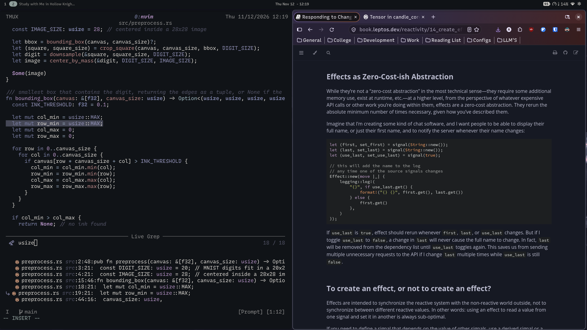
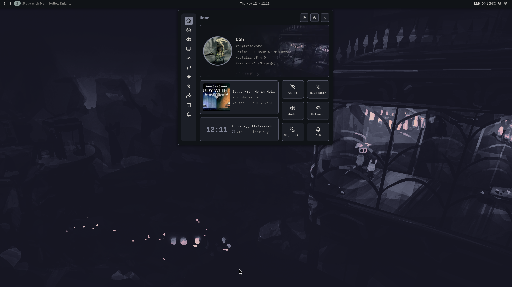

# dotfiles

My NixOS configuration for a Framework 13 AMD laptop. The system is defined in a flake, and app configs are symlinked into place with GNU Stow, so a fresh install can be rebuilt from this repo.





## Setup

- **OS:** NixOS (flakes)
- **Compositor:** niri
- **Shell:** Noctalia
- **Editor:** Neovim
- **Terminal:** WezTerm + tmux
- **Prompt:** Starship on zsh
- **Keyboard:** kanata for remapping and vim-style navigation
- **Theming:** stylix with a custom Vague-inspired palette

## Hardware tweaks

- Suspend/resume fixes for the Framework 13 AMD (s2idle, `pcie_aspm=off`)
- Battery charge limiting
- Fingerprint login via fprintd and PAM
- VA-API hardware video acceleration

## Layout

```
.
├── flake.nix            # entry point, inputs and the framework host
├── host/
│   ├── base.nix         # settings shared across machines
│   └── framework/       # hardware and host-specific config
├── modules/
│   ├── system.nix       # core system services and packages
│   ├── dev.nix          # development tooling
│   └── stylix.nix       # system-wide theming
├── pkgs/
│   ├── default.nix      # custom packages
│   └── fonts/           # bundled fonts
├── .config/             # app configs, symlinked with Stow
│   ├── niri/  noctalia/  nvim/  tmux/  wezterm/  ...
│   └── starship.toml
└── .zshrc
```

`.config/` also keeps configs from my earlier Hyprland setup (hypr, waybar, rofi, mako, and others) for reference.

## Install

```bash
git clone https://github.com/r-Dev03/dotfiles.git ~/dotfiles
cd ~/dotfiles

# Rebuild the system
sudo nixos-rebuild switch --flake .#framework

# Symlink app configs into ~
stow .
```
